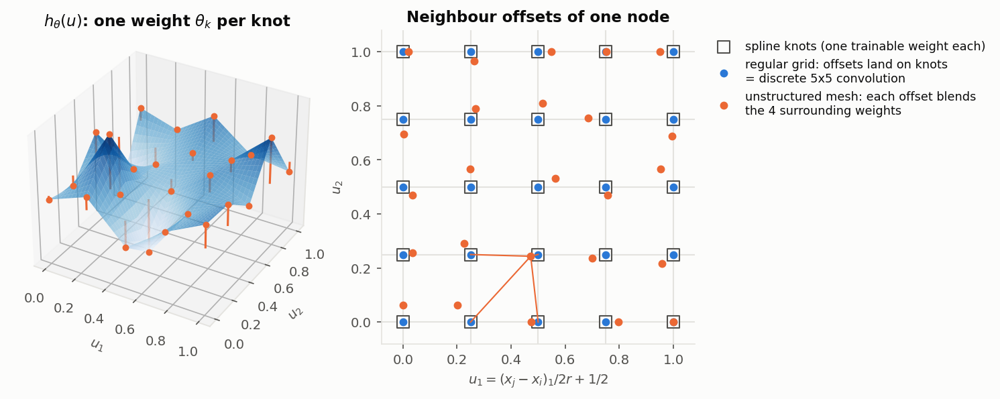
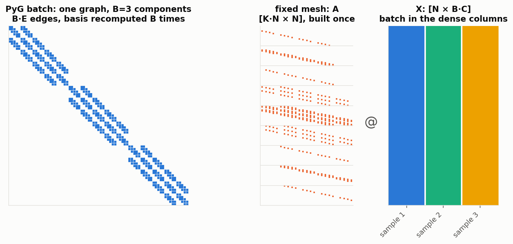
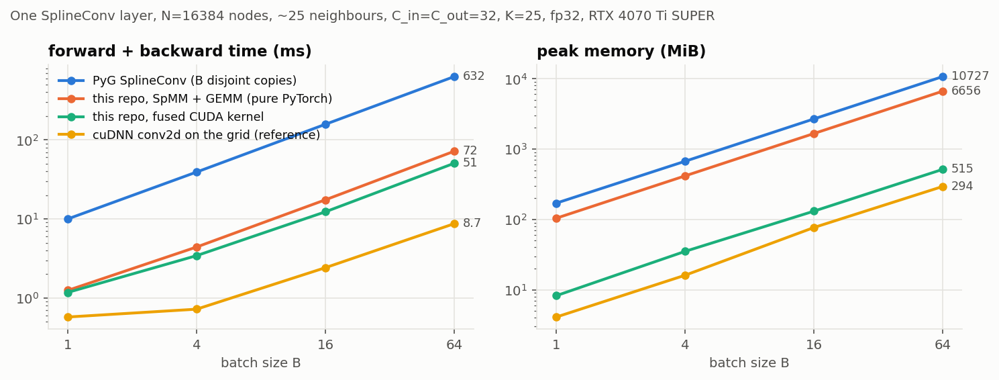
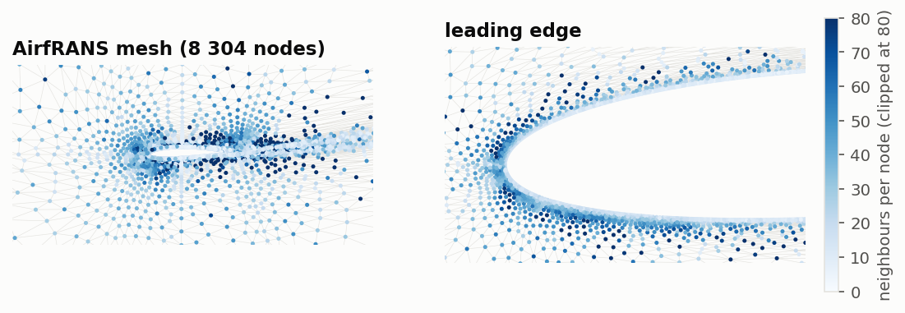
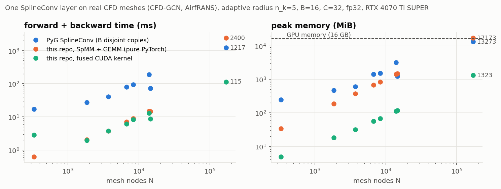

# batched-splineconv

**Batched SplineConv for fields that all live on the same mesh.**

Surrogate models for simulations often learn maps between fields discretised on *one*
unstructured mesh, shared by every sample of the dataset. Graph libraries batch such
data as one large graph with `B` disjoint copies of the mesh. That treats geometry
that is identical across the batch as if it were different, and pays for it `B` times.
This repository rewrites `SplineConv` (Fey et al., 2018) for the fixed-mesh case as
**one precomputed sparse operator shared by the whole batch**. It checks the result
against PyG and against cuDNN convolutions, and benchmarks it.

```python
from batched_splineconv import SplineOperator, FixedMeshSplineConv

op = SplineOperator(edge_index, pseudo, kernel_size=5, num_nodes=N).cuda()  # once per mesh
conv = FixedMeshSplineConv(in_channels=32, out_channels=32, dim=2, kernel_size=5).cuda()
y = conv(x, op)               # x: [B, N, 32] -> y: [B, N, 32]
```

`order="auto"` (default) picks the fused CUDA kernel or one of the two pure-PyTorch
contraction orders per layer, from the layer's shape (see §4.2).

---

## 1. Why SplineConv: a convolution that does not need a grid

On a regular grid, the decoder of a convolutional surrogate is a stack of (transposed)
convolutions. Each output node aggregates its neighbours with a weight that depends
only on their **offset**:

$$X^{out}_i = \frac{1}{|\mathcal N(i)|}\sum_{j\in\mathcal N(i)} w_{\vec x_j-\vec x_i}\, X^{in}_j$$

On an unstructured mesh, offsets $x_j - x_i$ take arbitrary values, so a lookup table
$w_{\vec d}$ no longer makes sense. SplineConv replaces it with a *continuous* kernel
$h_\theta(x_j - x_i)$, a tensor-product B-spline whose control values $\theta_k$ are the
trainable weights:

$$X_i \leftarrow \frac{1}{|\mathcal N(i)|}\sum_{j\in\mathcal N(i)} h_\theta(x_j - x_i)\, X_j,
\qquad h_\theta(u) = \sum_k B_k(u)\,\theta_k .$$



Two properties make it the natural generalisation of a grid convolution:

* **Same expressivity and parameterisation on a grid.** With degree-1 splines, a
  kernel size of `2r+1`, and offsets scaled so that grid offsets land on the knots (blue
  points above), the basis is one-hot: $h_\theta(\vec d) = \theta_{\vec d}$. Each
  offset owns exactly one trainable weight, as in a discrete kernel. The layer then
  *is* `conv2d` / `conv3d` / `conv_transpose2d`, with the same parameter count and the
  same dependence of the output on the parameters. This is checked exactly in
  [`tests/test_grid_equivalence.py`](tests/test_grid_equivalence.py).
* **Smooth in the geometry.** On an unstructured mesh, each offset blends the $2^d$
  surrounding weights (orange points). $h_\theta$ is Lipschitz, so moving the nodes a
  little changes the output a little. Two edges with similar offsets get similar
  weights, which is what you want if the network should not care too much about the
  particular mesh. The test `test_smooth_under_mesh_perturbation` checks that the
  output varies *linearly* with the node jitter.

The same construction gives mesh-to-mesh layers (pooling and unpooling between a mesh
hierarchy): a bipartite graph from the nodes of one mesh to those of the next, as a
strided transposed convolution does between grids.

## 2. The cost of batching fixed-mesh data as disjoint graphs

```
out_i = c_i * sum_{j in N(i)} sum_s B_s(u_ij) * x_j @ W[k_s(u_ij)]   (+ x_i @ W_root + b)
```

In PyG, a batch of `B` fields is one graph with `B` connected components. For each of
the `B·E` edges, `SplineConv` (1) recomputes the `S = (degree+1)^d` basis values and
weight indices, and (2) multiplies a single row `x_j` by a `C_in × C_out` matrix. That
is a memory-bound vector-matrix product, followed by a scatter with atomics, and a
backward pass that accumulates `∂W` with atomics edge by edge.

When the mesh is fixed, `B_s(u_ij)`, `k_s(u_ij)` and `c_i` are **constants**. Collect them
into one sparse tensor, built once:

$$
A[(k,i),j] = c_i \sum_{s : k_s(u_{ij})=k} B_s(u_{ij}), \qquad A \in \mathbb{R}^{K N_{dst} \times N_{src}}
$$

Then `out = Σ_k A_k X W_k`. If the batch is stored **in the dense columns**,
`X : [N, B·C_in]`, the whole layer reduces to one SpMM and one GEMM:



| order | computation | intermediate |
|---|---|---|
| `aggregate` | `Z = A @ X` → reshape `[N·B, K·C_in]` → `Z @ W.view(K·C_in, C_out)` | `K·N·B·C_in` |
| `transform` | `Y = X @ [W_1 … W_K]` → reshape `[K·N, B·C_out]` → `A' @ Y` | `K·N·B·C_out` |

`order="auto"` picks whichever of the two has the smaller intermediate. The backward
pass is `Aᵀ @ grad` with a precomputed `Aᵀ`, plus dense GEMMs, so it uses no atomics
and is deterministic. This path is plain PyTorch (`torch.sparse` CSR plus `matmul`).

**Fused kernel (`order="fused"`).** The SpMM path still writes `Z` to global memory:
`K` times the size of the input (25× for a 5×5 kernel). The fused CUDA kernel never
materialises it:

* each block owns a tile of rows `(i, b)` (destination node × sample) and output channels;
* for each kernel cell `k`, it gathers `Z_k` for its rows into shared memory, using a CSR
  sorted by `(i, k)`, and accumulates `Z_k @ W_k` in registers;
* tiles that have no neighbour in cell `k` skip the GEMM.

The same kernel on the transposed operator gives `∂X`. `∂W_k = Z_kᵀ ∂out` recomputes
`Z_k` on the fly, with a split-K reduction into a partials buffer. The backward pass
therefore uses no atomics and is deterministic. Tile shapes adapt to the channel counts
(16 / 32 / 64), so narrow layers do not waste FLOPs on padding.

## 3. Tests, and what each one establishes

| test | establishes |
|---|---|
| `test_basis.py` | our pure-PyTorch B-spline basis equals `torch_spline_conv.spline_basis` (degrees 1–3, open and closed, 1D–3D, CPU and CUDA) |
| `test_vs_pyg.py::test_same_mesh` | `FixedMeshSplineConv(x, op)` equals PyG `SplineConv` on `B` disjoint copies, **forward and all gradients** (`∂x, ∂W, ∂W_root, ∂b`), to 1e-10 in float64. This covers 2D/3D, degrees 1–3, open/closed, mean/add, and both contraction orders. |
| `test_vs_pyg.py::test_bipartite_mesh` | same for mesh-to-mesh (pooling/unpooling) layers |
| `test_grid_equivalence.py` | on a regular grid the layer is exactly `conv2d` (r=1,2), `conv3d`, and stride-2 `conv_transpose2d` (the upsampling layer of a convolutional decoder) |
| `test_smooth_under_mesh_perturbation` | the output is Lipschitz in the node positions (linear response to jitter) |
| `test_fused.py` | the fused CUDA kernel equals the SpMM path (forward and all gradients) for 2D/3D, degrees 1–3, channel counts that are not multiples of the tile sizes (2…130), bipartite operators with isolated nodes, and is bit-for-bit deterministic |

```bash
pip install -e ".[test]"                      # pure-PyTorch paths
BSC_BUILD_CUDA=1 pip install -e ".[test]"     # + ahead-of-time build of the fused kernel
pytest
```

Without the ahead-of-time build, the fused kernel is JIT-compiled on first use. That
needs `nvcc` and a host compiler at runtime; on Windows, run from a "x64 Native Tools"
prompt or after `vcvars64.bat`.

The tests compare against PyG through `torch_spline_conv`. Recent PyG releases (2.8)
moved the spline ops to `pyg-lib>=0.6`. For older torch builds (no matching `pyg-lib`),
use `torch_geometric==2.6.1` with `torch_spline_conv`.

## 4. Benchmarks

### 4.1 Jittered grid

`python benchmarks/bench.py --size 128 --channels 32 --batches 1 4 16 64` runs one layer, forward plus
backward, on a jittered 128×128 grid. The pseudo-coordinates are continuous, so every
edge touches 4 spline weights, as on a real unstructured mesh. The plot is made with
`python docs/make_figures.py <csv>`.



* **SpMM + GEMM (pure PyTorch): ≈9× faster than PyG at every batch size, with 1.6×
  less memory.** This comes from computing the basis once and turning per-edge
  vector–matrix products into one SpMM and one GEMM over the whole batch. Its memory is
  dominated by the intermediate `Z`, which is `K = 25` times the size of the input.
* **Fused kernel: ≈13× less memory than the SpMM path (21× less than PyG), within 1.75×
  of cuDNN on the equivalent grid, and ≈1.4× faster than the SpMM path for B ≥ 16.**
* **Time is still ≈6× behind cuDNN.** The fused kernel runs at ~5 TFLOP/s in fp32 SIMT
  (`benchmarks/profile_fused.py`). The next steps are overlapping the gather with the
  GEMM and moving the GEMM to tensor cores (see roadmap).

With 64 channels, memory becomes the deciding factor (16 GB card):

| C_in = C_out = 64, N = 16384 | B = 16 | B = 64 |
|---|---|---|
| PyG | 578 ms / 5.1 GB | 4333 ms / 20.3 GB (spills to host memory) |
| SpMM + GEMM (best order) | 36 ms / 3.3 GB | 683 ms / 13.6 GB (spills) |
| fused kernel | **27 ms / 0.27 GB** | **115 ms / 1.0 GB** |
| cuDNN conv2d on the grid | 5.3 ms / 0.16 GB | 22 ms / 0.60 GB |

### 4.2 Real CFD meshes

A jittered grid has uniform density, uniform degree and a cache-friendly numbering.
Real CFD meshes have none of these. `benchmarks/download_meshes.py` fetches real 2D meshes
around airfoils, and `benchmarks/bench_real.py` runs the same layer on them:

* the SU2 meshes of **CFD-GCN** (Belbute-Peres et al., ICML 2020): NACA0012, NACA4412 and
  RAE2822 at several resolutions, from 332 to 14 576 nodes;
* one simulation of **AirfRANS** (Bonnet et al., NeurIPS 2022, ODbL), both remeshed
  (8 304 nodes) and at its original OpenFOAM resolution (169 078 nodes, boundary-layer
  refinement). Only that sample is streamed out of the archives.

The meshes are downloaded, not redistributed. Connectivity is the continuous-kernel criterion
`|x_j − x_i| ≤ (√2/2)·n_k·h_i` with the local mesh spacing `h_i` (n_k = 5): the
neighbourhood follows the refinement, so the degree varies across the mesh (below).



**Layers on one mesh** (B = 16, C = 32; node orderings mesher / random / RCM compared):



* Up to 15k nodes: SpMM and fused paths are **5–20× faster than PyG**. The fused kernel
  is as fast or slightly faster than SpMM and uses **10–13× less memory**.
* On the 169k-node AirfRANS mesh, only the fused kernel fits comfortably: **115 ms /
  1.3 GB**, against 0.9–1.2 s / 13 GB for PyG and 2.3 s / 17 GB for SpMM, which spills
  to host memory.
* **Node ordering does not matter** (mesher, random or Reverse Cuthill–McKee within
  ±15%): the gathers are not limited by locality on these meshes.

**Mesh-to-mesh layers** (hierarchical encoder/decoder). The layer resamples between two
meshes of very different sizes, and there the SpMM orders win, because they do the
dense work on the smaller mesh:

| layer (B = 16, C = 32) | PyG | SpMM (order) | fused | `auto` picks |
|---|---|---|---|---|
| NACA0012 1843 → 6684 nodes (up) | 39 ms | **2.1 ms** (transform) | 4.6 ms | transform |
| NACA4412 3704 → 14576 (up) | 280 ms | **6.7 ms** (transform) | 17.5 ms | transform |
| AirfRANS 8304 → 169078 (up) | 3.1 s / 18 GB | **64 ms / 1.2 GB** (transform) | 256 ms / 0.7 GB | transform |
| NACA0012 6684 → 1843 (down) | 106 ms | **3.0 ms** (aggregate) | 11 ms | aggregate |
| AirfRANS 169078 → 8304 (down) | 5.6 s / 33 GB | **42 ms / 1.1 GB** (aggregate) | 300 ms / 0.7 GB | aggregate |

`order="auto"` uses an SpMM order when its intermediate is at most 8× the layer's
input + output, which is the case for resampling layers. Otherwise it uses the fused
kernel (CUDA, fp32). On these benchmarks it picks the fastest path, or one within 2 ms
of it.

### 4.3 End-to-end hierarchical U-Net on the 169k-node mesh

`benchmarks/bench_unet.py` decimates the original AirfRANS mesh into 7 levels, with about
3× fewer nodes per level: 169 078 → 58 661 → 20 085 → 6 407 → 2 051 → 661 → 211. The
decimation is a variable-radius Poisson-disk sampling (`meshes.mesh_hierarchy`), so the
refinement near the airfoil is preserved. On this hierarchy it builds a U-Net as in a
hierarchical mesh surrogate:

* per level, one same-mesh layer in the encoder and one in the decoder, with skip
  connections;
* down / up mesh-to-mesh layers between levels;
* 25 SplineConv layers, channels 32 → 128, 6.2 M parameters.

The same network is built with PyG and with this library. Their outputs agree to
1.7e-7 (relative, fp32). Forward + backward, total peak GPU memory (geometry and model
included):

| B | PyG | SpMM orders only | `auto` (fused + SpMM) |
|---|---|---|---|
| 1 | 950 ms / 6.3 GB | **51 ms** / 3.4 GB | 82 ms / **2.4 GB** |
| 2 | 1.9 s / 11.2 GB | **94 ms** / 5.5 GB | 123 ms / **3.3 GB** |
| 4 | 68 s / 21 GB (spills) | **187 ms** / 9.6 GB | 216 ms / **5.1 GB** |
| 8 | 31 s / 40 GB (spills) | 1.8 s / 17.7 GB (spills) | **398 ms / 8.8 GB** |
| 16 | out of memory | 35 s / 34 GB (spills) | **1.4 s** / 16.1 GB (at the limit) |

* Per sample, the library is ~19× faster than PyG at its best batch size, and
  ~2.5× better with `auto` at B = 8 against PyG at B = 1.
* `auto` gives up up to 60% of speed at small B against the SpMM-only path. In exchange
  it halves the memory, which is what lets B = 8 fit on a 16 GB card.
* The geometry (19 operators, 11.9 M edges) takes 1.4 GB. Each operator only builds the
  sparse layouts its layers use, with int32 indices.

## 5. Roadmap

- [x] fixed-mesh operator, two contraction orders, deterministic backward
- [x] equivalence tests (PyG, conv2d/3d, conv_transpose2d), smoothness test
- [x] benchmark against PyG and cuDNN
- [x] **fused CUDA kernel** (`order="fused"`), forward and backward, deterministic
- [ ] fused kernel: software pipelining (gather tile `k+1` while multiplying tile `k`)
- [ ] fused kernel: tensor cores (TF32 / bf16 `mma`), the GEMM part is ~90% of the FLOPs
- [x] real CFD meshes (CFD-GCN, AirfRANS), same-mesh and mesh-to-mesh layers
- [ ] fused kernel for resampling layers: transform-first variant (GEMM on the smaller
      mesh), and splitting the very long rows of high-degree nodes (up to 34k neighbours
      in AirfRANS 169k → 8k)
- [x] mesh hierarchy generation and end-to-end U-Net benchmark on a 169k-node mesh
- [ ] fused kernel at small batch / wide layers (C = 128), where the SpMM path is still faster
- [ ] 3D meshes
- [ ] upstream: static-graph support for `SplineConv` in PyG (documented, but currently fails)
- [ ] other operators whose geometry is fixed (GMMConv, NNConv with fixed edge features)

## Notes

* **Layout.** Internally features are `[N, B, C]`, so a node's batch of features is
  contiguous: one gather reads `B·C` values. Pass `layout="NBC"` to avoid the two
  transposes when stacking layers.
* **A PyTorch pitfall found on the way.** With torch **2.4.0** on an Intel Core Ultra 7
  265K, `torch.sort` / `torch.unique` / `coalesce()` on CPU integer tensors of ≥ 32768
  elements return wrong, non-deterministic results. The same build also reports a
  single intra-op thread on that CPU. It is fixed in 2.4.1 and later (checked: 2.4.1,
  2.5.1, 2.6.0, 2.14.1). To be safe on any build, the operator is assembled with numpy,
  which only happens once per mesh.

## References

* M. Fey, J. E. Lenssen, F. Weichert, H. Müller. *SplineCNN: Fast Geometric Deep
  Learning with Continuous B-Spline Kernels.* CVPR 2018.
* Reference implementation: [rusty1s/pytorch_spline_conv](https://github.com/rusty1s/pytorch_spline_conv).
* L. Meyer, L. Pottier, A. Ribes, B. Raffin. *Deep Surrogate for Direct Time Fluid
  Dynamics.* NeurIPS 2021 Workshop on Machine Learning and the Physical Sciences.
  [arXiv:2112.10296](https://arxiv.org/abs/2112.10296). This is the hierarchical
  spline-convolution surrogate (a sequence of meshes of increasing resolution, all
  samples on the same meshes) that motivated this repository.

```bibtex
@misc{meyer2021deep,
  title         = {Deep Surrogate for Direct Time Fluid Dynamics},
  author        = {Meyer, Lucas and Pottier, Louen and Ribes, Alejandro and Raffin, Bruno},
  year          = {2021},
  eprint        = {2112.10296},
  archivePrefix = {arXiv},
  primaryClass  = {cs.LG},
  note          = {NeurIPS 2021 Workshop on Machine Learning and the Physical Sciences}
}
```

## License

MIT, see [LICENSE](LICENSE).
